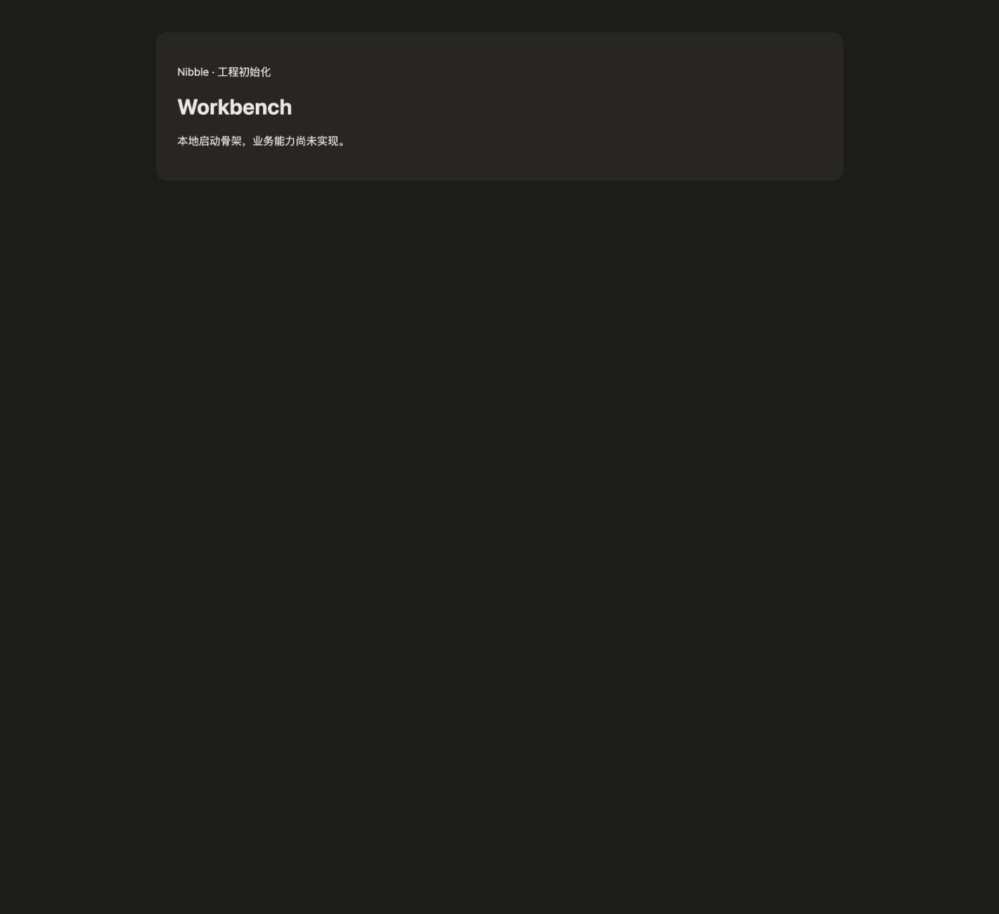

# 工程初始化与验证入口

Status: Current
Owner: 项目维护者
Last verified: 2026-11-16 — #30 候选默认入口及命令核对；原生交互 not verified

## 环境与命令

Node 26.13.0、pnpm 12.18.0、Rust 1.99.1；工具链文件与两端锁文件提交。当前本地为 Intel x86_64 macOS 26.7.1，Command Line Tools；不是 Apple Silicon 产品支持验收。CI 使用 macos-15，确切环境以运行记录为准。

```sh
pnpm install --frozen-lockfile
pnpm dev
pnpm format:check
pnpm lint
pnpm typecheck
pnpm test
pnpm build
```

仅桌面开发需 Xcode Command Line Tools 与 Rust；通过 rustup 可按 rust-toolchain.toml 安装工具链。本地 MacPorts Rust 版本相同但没有 rustup；CI 显式安装固定工具链。

初始化基线创建 Workbench 可见与 Quick Panel 隐藏的两个窗口。#30 候选已在默认入口接入托盘、单实例、默认快捷键及窗口协调，接口和实机缺项见[窗口生命周期服务](window-lifecycle.md)；业务尚未实现。pnpm dev:web 只运行浏览器前端，不能验证 IPC 或原生行为。build 构建真实应用可执行文件但不打公开安装包。临时单色图标仅用于开发编译，不是品牌交付。

## 模块与 IPC

src/surfaces 为独立界面入口，src/ipc 使用 Rust 生成的 bindings.ts。初始化元信息命令保留，#30 新增分窗口生命周期命令与版本通知，精确权限见[窗口服务](window-lifecycle.md#ipc-和最小权限)；没有文件、剪贴板、shell 或前端插件注册权限。应用命令通过 build.rs app manifest 显式参与 ACL。

pnpm bindings:generate 生成类型；bindings:check 在生成前保存内容再比较，漂移则失败。前端代码导入生成类型，不手写重复契约。生成器不代替输入及权限验证。本阶段唯一命令没有用户输入。

## 依赖与风险

选择来源：[Vite 配置](https://v2.tauri.app/start/frontend/vite/)、[Specta 集成](https://specta.dev/docs/tauri-specta)。注册表核实可用组合为 specta 2.0.0-rc.28、tauri-specta 2.0.0-rc.29、specta-typescript 0.0.15，均精确 pin；文档示例 RC.27 不可获取，未照抄。Tauri 2.12.5 / tauri-build 2.7.4 由 Cargo.lock 锁定。TypeScript 7 与当前 typescript-eslint peer 范围不兼容，使用 6.0.3。

npm 包从 registry.npmjs.org 安装，Rust 从 crates.io，许可证需以包内声明和锁文件对应源码为准。下表来自实际安装包。升级单独 PR，检查生成差异、许可、测试和构建；RC 可能破坏 API。回退恢复此前整组清单及锁文件，不单独混用 RC。

| npm 包 | 精确版本 | 声明许可 | 用途 |
|---|---|---|---|
| @tauri-apps/api | ^2.12.4 | Apache-2.0 OR MIT | dependencies |
| react | 19.3.1 | MIT | dependencies |
| react-dom | 19.3.1 | MIT | dependencies |
| @eslint/js | 10.0.1 | MIT | devDependencies |
| @tauri-apps/cli | ^2.12.4 | Apache-2.0 OR MIT | devDependencies |
| @testing-library/dom | 10.4.2 | MIT | devDependencies |
| @testing-library/jest-dom | 7.0.1 | MIT | devDependencies |
| @testing-library/react | 16.3.3 | MIT | devDependencies |
| @types/node | 26.6.6 | MIT | devDependencies |
| @types/react | 19.3.0 | MIT | devDependencies |
| @types/react-dom | 19.3.0 | MIT | devDependencies |
| @vitejs/plugin-react | 6.3.0 | MIT | devDependencies |
| eslint | 10.14.0 | MIT | devDependencies |
| eslint-plugin-react-hooks | 7.1.1 | MIT | devDependencies |
| eslint-plugin-react-refresh | 0.5.7 | MIT | devDependencies |
| jsdom | 31.0.0 | MIT | devDependencies |
| prettier | 3.10.1 | MIT | devDependencies |
| typescript | ~6.0.3 | Apache-2.0 | devDependencies |
| typescript-eslint | 8.72.2 | MIT | devDependencies |
| vite | 8.3.8 | MIT | devDependencies |
| vitest | 5.1.0 | MIT | devDependencies |

Rust 直接依赖：tauri 与 tauri-build 为 MIT OR Apache-2.0，serde 为 MIT OR Apache-2.0，Specta 系列为 MIT。传递依赖以 Cargo.lock 和 pnpm-lock.yaml 为完整解析基线；pnpm peers check 应无冲突。许可/已知漏洞的完整扫描结果在 PR 中记录，未执行不能宣称分发许可合规已通过。当前不分发浏览器、字体或额外资源。

## 验证范围

初始化组件合同检查两界面未实现状态；IPC 合同检查生成调用及传输失败传播；Rust 检查无内容元信息。#30 候选新增会话、关闭/恢复失败顺序、权限及版本同步测试，详见[窗口服务](window-lifecycle.md)。CI 完成格式、lint、类型/生成、测试、原生 build。不包含实机焦点、Space、多屏、权限或产品验收。main 保护与模板实际启用证据见[协作设施](collaboration-guardrails.md)。

## 初始依赖审计记录

pnpm audit 报告一项开发依赖 minimatch 中等级 glob 放大 DoS（GHSA-g3hv-75wg-m249）；当前 10.2.6，修复版要求 >=11.0.1。它用于本仓库受控 lint 路径，不进入应用运行时。未擅自强制跨 major override；此已知风险需初始化 PR 维护者审阅，后续通过工具链更新消除。Rust metadata 全部传递包有许可声明；存在 MPL-2.0 和多许可选项，后续公开分发需汇总通知义务，不能宣称已完成法律合规审查。Rust 漏洞库扫描未执行。

## 初始化执行证据（历史）

本地及独立干净目录（无 node_modules、dist、target）均完成冻结安装、format:check、lint、typecheck/绑定漂移、3 项前端测试、1 项 Rust 测试及 Tauri release 构建。pnpm peers check 无冲突。浏览器核对两个入口的未实现提示，以下仅为浏览器渲染，不证明原生窗口行为：



远端 CI 结果以 PR checks 为准；最小原生启动与完整产品验收分别记录，不混用。

本地 release 可执行文件启动后保持运行，但原生 UI 检查工具无法绑定未打包可执行文件；因此没有将进程存活计作原生窗口或 IPC 实机验收通过。原生日志出现 IMK mach-port 诊断，未见 Rust 启动失败；具体原生体验仍由风险验证任务承接。

## 隔离原生风险探测

`pnpm dev:probe` / `pnpm build:probe` 显式启用 `native-probe` Cargo feature。
操作、依赖、回退和实机证据边界见[原生风险探测](native-window-probe.md)。默认启动仍为初始化双窗口，不启用探测原生代码。
