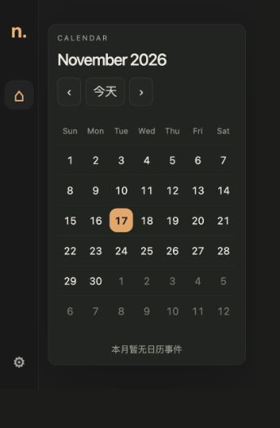

# Workbench 深色外壳与月历候选

Status: Draft
Owner: 项目维护者
Last verified: 2026-11-17 — 自动化、原生构建与浏览器窄窗核对；原生交互 not verified

对应[实现 Workbench 深色外壳与真实月历](https://github.com/NibbleOrg/Nibble-desktop/issues/31)。产品合同见[交互与视觉](../product/interaction.md)，使用入口见[用户指南](../product/user-guide.md)。本页为实现证据，不替代原生验收。

## 实现与边界

`src/surfaces/calendar.ts` 只生成本地公历日期，使用本地正午避开夏令时午夜偏移。`CalendarView.tsx` 以系统默认 Intl locale 格式化公历标签，通过 Intl.Locale 的 getWeekInfo / weekInfo 读取地区周首日；不支持该 API 的旧环境退回周一，目标 WebKit 的系统地区及用户周首日覆盖仍需实机核对。每次窗口获焦、语言变化和每 30 秒刷新当前日期；浏览中的月份不会随午夜跳转。“今天”即时读取系统日期。

`App.tsx` 保留同一个 Calendar 实例，切换设置仅隐藏内容；月份没有持久化。沿用窗口服务隐藏不卸载的约定，完整重启重新创建 Home 当前月。现有设置导航请求及确认命令保持不变；没有新增 IPC、Capability、原生代码、权限或依赖。Quick Panel 业务保持原有骨架。

`Workbench.module.css` 提供 Ink rail、底部设置、日期网格、200ms 路由淡入与月份方向交叉淡入；CSS 系统减少动态偏好与原生 snapshot.reducedMotion 均禁用动画。退出月份的视觉层对辅助技术隐藏，200ms 后清除；快速切换会替换退出层并取消旧计时，视觉精调仍待原生验收。小窗口允许内容区域独立滚动，导航轨道保持可达。没有事件、导入、工具编辑或未来模块占位。

## 验证证据

本机 Intel x86_64 / macOS；精确工具链与启动命令见[初始化](bootstrap.md)。日期单测先运行因缺 `calendar` 模块失败，实现后通过。

- `pnpm format:check`、`pnpm lint`、`pnpm typecheck`：通过（含 Rust fmt/clippy、生成绑定漂移）。
- `pnpm test`：10 项前端及 22 项 Rust 测试通过；追加原生设置导航与 reduced motion 参数测试后，`pnpm exec vitest run` 共 11 项通过。
- `pnpm build`：Tauri release 可执行文件构建成功，无公开安装包。
- 自动化覆盖闰年、相邻月、42 格、US/GB/SA 周首日、月份前后/今天、设置往返保留、重新挂载重置、跨午夜更新、原生设置请求确认与减少动态参数。
- 浏览器默认地区 en-US 的真实日期显示及 380×580 窄窗截图核对：六行日期、月份导航、今天及底部设置均可见。浏览器无原生窗口服务，不能验证原生显隐与 IPC。

## 待实机验收

以下均 **not verified**，保留 draft，不自评关闭议题：

1. `pnpm dev` 启动 Home 当前月，浏览后设置往返、关闭隐藏、托盘/Dock 重开保留路由和月份；⌘Q 后重启重置。
2. 从 Quick Panel 用 ⌘, 导航到 Settings → Quick Panel，返回 Home 保留月份；原生协调集成场景。
3. 系统不同地区、周首日覆盖、时区变化和午夜唤醒；至少核对周一与周日起始地区、非公历默认地区仍显示公历。
4. 原生窄窗口滚动、键盘焦点可见、底部设置可达；200ms 路由/月份运动及系统减少动态开关下无位移/淡入。
5. Apple Silicon 上的真实窗口截图/短录屏。远端 CI、独立 CR 尚待 PR 记录，均 not verified。

回退恢复本票前端与文档文件即可；无持久数据、迁移、原生权限或发布变更。
